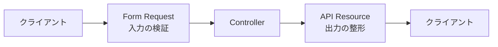

# Laravel Sail Cheatsheet

Laravel Sail環境で、模擬案件を実装するときに使用するコマンドの早見表。

> [!NOTE]
> 以下では正式な書き方として `./vendor/bin/sail` を使用する。
>
> Sailのエイリアスを設定している場合は、`./vendor/bin/sail` を `sail` に置き換えられる。

---
### 【頻出】
```
# Sailをバックグラウンドで起動する
./vendor/bin/sail up -d

# 未実行のマイグレーションを実行する
./vendor/bin/sail artisan migrate

# DBを作り直してSeederを実行する
./vendor/bin/sail artisan migrate:fresh --seed

# 登録されているルートを確認する
./vendor/bin/sail artisan route:list

# テストをすべて実行する
./vendor/bin/sail artisan test

# PHPコードを自動整形する
./vendor/bin/sail pint
```

---
## 0. Sailの起動・終了

### バックグラウンドで起動

```bash
./vendor/bin/sail up -d
```

### 起動状態を確認

```bash
./vendor/bin/sail ps
```

### Sailを停止

```bash
./vendor/bin/sail stop
```

### コンテナを停止・削除

```bash
./vendor/bin/sail down
```

### ボリュームも含めて削除

```bash
./vendor/bin/sail down -v
```

> [!WARNING]
> `down -v` を実行すると、MySQLのデータも削除される場合がある。

---

# 1. マイグレーション作成

対象：

- users
- tasks
- categories

## マイグレーションファイルを作成

```bash
./vendor/bin/sail artisan make:migration create_users_table
```

```bash
./vendor/bin/sail artisan make:migration create_tasks_table
```

```bash
./vendor/bin/sail artisan make:migration create_categories_table
```

## 既存テーブルにカラムを追加

```bash
./vendor/bin/sail artisan make:migration add_category_id_to_tasks_table --table=tasks
```

## マイグレーションを実行

```bash
./vendor/bin/sail artisan migrate
```

## マイグレーション状況を確認

```bash
./vendor/bin/sail artisan migrate:status
```

## 直前のマイグレーションを戻す

```bash
./vendor/bin/sail artisan migrate:rollback
```

## すべてのテーブルを作り直す

```bash
./vendor/bin/sail artisan migrate:fresh
```

## テーブルを作り直してSeederも実行

```bash
./vendor/bin/sail artisan migrate:fresh --seed
```

> [!WARNING]
> `migrate:fresh` は既存のテーブルとデータをすべて削除する。

---

# 2. モデル作成とリレーション定義

## モデルのみ作成

```bash
./vendor/bin/sail artisan make:model Task
```

```bash
./vendor/bin/sail artisan make:model Category
```

## モデルとマイグレーションを同時作成

```bash
./vendor/bin/sail artisan make:model Task -m
```

## モデル・マイグレーション・Factory・Seederを作成

```bash
./vendor/bin/sail artisan make:model Task -mfs
```

## モデルに関連するファイルをまとめて作成

```bash
./vendor/bin/sail artisan make:model Task -a
```

> [!NOTE]
> `-a` はモデルに関連するマイグレーション、Factory、Seeder、Controllerなどをまとめて作成する。
>
> 必要のないファイルまで作られるため、学習中は個別に作成してもよい。

---

# 3. 認証機能の実装（Fortify）

## Fortifyをインストール

```bash
./vendor/bin/sail composer require laravel/fortify
```

## Fortifyの初期ファイルを作成

```bash
./vendor/bin/sail artisan fortify:install
```

## マイグレーションを実行

```bash
./vendor/bin/sail artisan migrate
```

## キャッシュをクリア

```bash
./vendor/bin/sail artisan optimize:clear
```

## フロントエンドパッケージをインストール

```bash
./vendor/bin/sail npm install
```

## Viteを起動

```bash
./vendor/bin/sail npm run dev
```

## 本番用にビルド

```bash
./vendor/bin/sail npm run build
```

---

# 4. カテゴリーCRUD実装

## Controllerを作成

```bash
./vendor/bin/sail artisan make:controller CategoryController
```

## Resource Controllerを作成

```bash
./vendor/bin/sail artisan make:controller CategoryController --resource
```

## モデルと紐づいたResource Controllerを作成

```bash
./vendor/bin/sail artisan make:controller CategoryController --resource --model=Category
```

## Form Requestを作成

```bash
./vendor/bin/sail artisan make:request StoreCategoryRequest
```

```bash
./vendor/bin/sail artisan make:request UpdateCategoryRequest
```

## 登録されているルートを確認

```bash
./vendor/bin/sail artisan route:list
```

## Categoryに関するルートだけ確認

```bash
./vendor/bin/sail artisan route:list --name=categories
```

---

# 5. タスクCRUD実装

## Controllerを作成

```bash
./vendor/bin/sail artisan make:controller TaskController --resource --model=Task
```

## Form Requestを作成

```bash
./vendor/bin/sail artisan make:request StoreTaskRequest
```

```bash
./vendor/bin/sail artisan make:request UpdateTaskRequest
```

## Factoryを作成

```bash
./vendor/bin/sail artisan make:factory TaskFactory --model=Task
```

## Seederを作成

```bash
./vendor/bin/sail artisan make:seeder TaskSeeder
```

## Seederを実行

```bash
./vendor/bin/sail artisan db:seed
```

## 特定のSeederだけ実行

```bash
./vendor/bin/sail artisan db:seed --class=TaskSeeder
```

## データベースを作り直してSeederを実行

```bash
./vendor/bin/sail artisan migrate:fresh --seed
```

---

# 6. タスクPolicy実装

## Policyを作成

```bash
./vendor/bin/sail artisan make:policy TaskPolicy
```

## Taskモデルと紐づけてPolicyを作成

```bash
./vendor/bin/sail artisan make:policy TaskPolicy --model=Task
```

## キャッシュをクリア

```bash
./vendor/bin/sail artisan optimize:clear
```

> [!TIP]
> Policyが反映されないと感じたときは、クラス名・名前空間・認証ユーザーを確認したうえで、`optimize:clear` を実行する。

---

# 7. 公開API実装

## API Controllerを作成

```bash
./vendor/bin/sail artisan make:controller Api/TaskController
```

## API Resource Controllerを作成

```bash
./vendor/bin/sail artisan make:controller Api/TaskController --api --model=Task
```

## API Resourceを作成

```bash
./vendor/bin/sail artisan make:resource TaskResource
```

## Resource Collectionを作成

```bash
./vendor/bin/sail artisan make:resource TaskCollection
```

## API用Form Requestを作成

```bash
./vendor/bin/sail artisan make:request Api/StoreTaskRequest
```

## APIルートを確認

```bash
./vendor/bin/sail artisan route:list --path=api
```

> [!NOTE]
> Form Requestは、クライアントから受け取った入力を検証する。
>
> API Resourceは、クライアントへ返すレスポンスを整形する。



---

# 8. CRUDテスト実装

## Featureテストを作成

```bash
./vendor/bin/sail artisan make:test TaskTest
```

```bash
./vendor/bin/sail artisan make:test CategoryTest
```

## Unitテストを作成

```bash
./vendor/bin/sail artisan make:test TaskTest --unit
```

## 全テストを実行

```bash
./vendor/bin/sail artisan test
```

## 特定のテストファイルを実行

```bash
./vendor/bin/sail artisan test tests/Feature/TaskTest.php
```

## テスト名を指定して実行

```bash
./vendor/bin/sail artisan test --filter=タスクを登録できる
```

## クラス名を指定して実行

```bash
./vendor/bin/sail artisan test --filter=TaskTest
```

## テストを途中で停止

```bash
./vendor/bin/sail artisan test --stop-on-failure
```

## PHPUnitを直接実行

```bash
./vendor/bin/sail phpunit
```

---

# 9. 認証テスト実装

## 認証用Featureテストを作成

```bash
./vendor/bin/sail artisan make:test Auth/AuthenticationTest
```

```bash
./vendor/bin/sail artisan make:test Auth/RegistrationTest
```

```bash
./vendor/bin/sail artisan make:test Auth/LogoutTest
```

## 認証テストのみ実行

```bash
./vendor/bin/sail artisan test tests/Feature/Auth
```

## 特定の認証テストを実行

```bash
./vendor/bin/sail artisan test tests/Feature/Auth/AuthenticationTest.php
```

---

# 10. APIテスト実装

## API用Featureテストを作成

```bash
./vendor/bin/sail artisan make:test Api/TaskApiTest
```

## APIテストのみ実行

```bash
./vendor/bin/sail artisan test tests/Feature/Api
```

## 特定のAPIテストを実行

```bash
./vendor/bin/sail artisan test tests/Feature/Api/TaskApiTest.php
```

## API関連のテスト名で絞り込む

```bash
./vendor/bin/sail artisan test --filter=Api
```

---

# よく使う補助コマンド

## Laravelのキャッシュをまとめて削除

```bash
./vendor/bin/sail artisan optimize:clear
```

以下のキャッシュをまとめてクリアする。

- config
- route
- view
- event
- application cache

## Tinkerを起動

```bash
./vendor/bin/sail artisan tinker
```

使用例：

```php
User::all();
```

```php
Task::first();
```

```php
Task::factory()->create();
```

Tinkerを終了：

```text
exit
```

## Laravelログを確認

```bash
./vendor/bin/sail logs
```

## Laravelコンテナのログを追跡

```bash
./vendor/bin/sail logs -f laravel.test
```

## コンテナ内でシェルを開く

```bash
./vendor/bin/sail shell
```

## rootユーザーでシェルを開く

```bash
./vendor/bin/sail root-shell
```

## Composerパッケージをインストール

```bash
./vendor/bin/sail composer install
```

## Composerパッケージを追加

```bash
./vendor/bin/sail composer require パッケージ名
```

## Composerのオートロードを更新

```bash
./vendor/bin/sail composer dump-autoload
```

## npmパッケージをインストール

```bash
./vendor/bin/sail npm install
```

## npm開発サーバーを起動

```bash
./vendor/bin/sail npm run dev
```

## コードフォーマットを実行

```bash
./vendor/bin/sail pint
```

## 変更対象を確認してからフォーマット

```bash
./vendor/bin/sail pint --test
```

---

# 実装時の基本ループ

```text
1. Sailを起動
2. 必要なファイルをartisanで作成
3. コードを実装
4. マイグレーション・Seederを実行
5. ルートや画面を確認
6. テストを作成・実行
7. Pintでコードを整形
8. Gitでコミット
```

```bash
./vendor/bin/sail up -d
```

```bash
./vendor/bin/sail artisan migrate
```

```bash
./vendor/bin/sail artisan route:list
```

```bash
./vendor/bin/sail artisan test
```

```bash
./vendor/bin/sail pint
```

---

# Sailコマンドの読み替え

通常のLaravelコマンド：

```bash
php artisan migrate
```

Sail環境：

```bash
./vendor/bin/sail artisan migrate
```

通常のComposerコマンド：

```bash
composer install
```

Sail環境：

```bash
./vendor/bin/sail composer install
```

通常のnpmコマンド：

```bash
npm run dev
```

Sail環境：

```bash
./vendor/bin/sail npm run dev
```