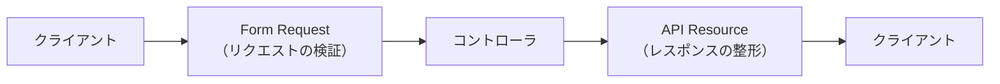

# Request と Resource の違い
どちらも「コントローラを薄く保つ」ための仕組みですが、担当する方向が正反対です。
- Requests は入口（受け取る側）
- Resources は出口（返す側）  
を担当します。

## APIの流れ



### 各役割

| クラス       | 役割      　　　 |
| ------------ | -------------- |
| Form Request | 入力データの検証 |
| Controller   | 処理の実行　　　 |
| API Resource | 出力データの整形 |

## FormRequest：入ってくるデータの検証
役割は「コントローラに処理を渡す前に、受け取ったデータが妥当かを検証すること」  

担当するのは以下3つ。
- authorize() : 実行可否
- rules() : 検証ルール
- messages() : エラーメッセージ  

検証に通れば $request->keyword のように普通に値を取り出せます。


## API Resource：出ていくデータの整形
役割は「モデル（DBのレコード）を、APIとして返すJSONの形に変換すること」

Resourceを使わずに return $book; と書くと、Laravelはモデルの全カラムをそのままJSONにします。　　
`↑※これは問題`
```
{
  "id": 1,
  "user_id": 3,
  "title": "リーダブルコード",
  "published_date": "2012-06-23T00:00:00.000000Z",
  "reviews_avg_rating": "4.5000",
  "created_at": "2026-07-18T05:12:33.000000Z"
}
```
DBの内部構造がそのまま外に漏れていて、日付は使いにくい形式、平均評価は文字列。   
**「DBがどうなっているか」** と **「APIが何を返すべきか」** は別物なのに、それが直結してしまっています。

Resourceはこの間に翻訳層を挟みます。
```
'published_date' => $this->published_date?->format('Y-m-d'),   💡 見やすい形に形式を指定
'average_rating' => round((float) $this->reviews_avg_rating, 2), 💡 数値に整形・改名
```

## そもそも、Requestとは？

>[!Tip] Requestの継承
BookIndexRequest は FormRequest を継承していますが、その FormRequest は Laravel の Request クラスを継承しています。

```
Request（HTTPリクエストを表すクラス）
  └ FormRequest（Requestにバリデーション機能を足したもの）
      └ BookIndexRequest（そこにルールを書いたもの）
``` 
> HTTPリクエスト：「クライアント(要求してきた相手)からの1回の要求」<br>
>>Web版：ユーザーがリンクをクリックしたり、フォームを送信したり、URLを入力したりした時にブラウザがサーバーに送る要求<br>
>>API版：HTTPリクエストの送り主は人間ではなくプログラムから送られる
```
public function index(Request $request)             // ただのリクエスト
public function index(BookIndexRequest $request)    // バリデーション済みのリクエスト
```
※ 後者は index() が呼ばれる前にバリデーションが完了している